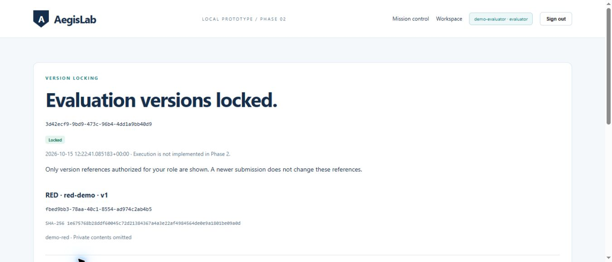
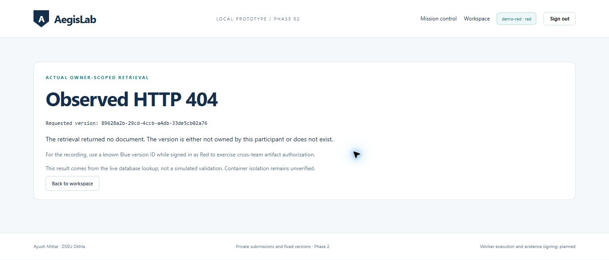

# Phase 2 recording checkpoint

Verified on 2026-10-15: 27 real authenticated API checks passed, eight foundation/HTTP checks passed, and browser sign-in/submission/locking/Red-to-Blue denial were exercised successfully. Non-database tests: 43 passed. Direct database tests from the agent sandbox remain connection-blocked, so trigger-mutation checks are unverified.

## Private preparation

Keep .env and local-data/demo_accounts.json off camera. The account file contains the only generated demo passwords; do not paste it into chat or recording logs.

~~~powershell
uv sync --locked
uv run --locked python -m aegislab.demo_setup
uv run --locked uvicorn aegislab.main:app --host 127.0.0.1 --port 8000 --reload
~~~

If the server is already running the Phase 2 code, keep it running. Setup is idempotent for the existing credentials and does not reset submissions or passwords. Phase 1's applied migration was preserved; 0002_private_versions is additive. Keep the same hostname (localhost) for browser login and API checks.

Privately prepare the demo-red and demo-evaluator passwords for the sign-in form. Password inputs are masked; never display the credentials file. The other synthetic accounts are demo-blue and demo-client.

## Short recording sequence

1. Show the terminal at the project root and run:

   uv run --locked python -m aegislab.demo_phase2

   The command authenticates all four accounts privately, submits actual fixtures, prints version IDs/digests, attempts unauthorized operations, creates an evaluation and verifies that a newer Red submission leaves its original references unchanged. Every PASS follows a real response. Network operations may take time; no sleeps or fake lifecycle progress are used. If anything fails, stop and inspect it.

2. Open http://localhost:8000/workspace. Sign in as demo-evaluator using the privately prepared password.

   Expected: the policy version is in the evaluator's own private history. Coordination metadata shows the Red, Blue and mock-model IDs/digests without their document bodies. Open the newest evaluation under Your evaluations; it shows four fixed metadata references and Execution not implemented in Phase 2.

3. Point to the locked Red version. The metadata list also contains a newer Red version created by the command.

   Expected: the existing evaluation still names the original Red version ID/digest. A later submission has not changed the lock.

4. Sign out and sign in as demo-red. Show its own version history and open the original version.

   Expected: Red can read its own original private document, and the newer version appears separately. Other participants' documents are absent from its listing.

5. Return to the Red workspace. Copy the known Blue version UUID from the demo command's final output into Try a version ID and submit.

   Expected: Observed HTTP 404 and no Blue document content. This is a real owner-scoped application lookup. Phrase the claim as "cross-team artifact retrieval denied in this test"; container isolation has not been implemented.

6. Open the same evaluation while signed in as Red.

   Expected: Red sees only its own locked reference. The version remains the original one. Worker execution, signed evidence and reports remain planned.

The receipt at local-data/phase2_receipt.json contains synthetic IDs, digests and successful-check labels, never passwords. It is an unsigned demo receipt, not a cryptographically verifiable evidence bundle. Re-running the command reuses identical artifact versions, creates another locked evaluation and overwrites this local receipt; it does not reset history.

## Narration

"AegisLab now authenticates Red, Blue, Client and Evaluator participants. Each role submits a small validated JSON document. The backend stores immutable versions and content digests, with owner-only retrieval. The evaluator coordinates using metadata and locks exact Red, Blue, mock-model and policy versions. A later Red submission creates a separate version without changing that evaluation. Red's attempt to retrieve a known Blue document returns 404. These are actual application checks. Isolated execution and signed evidence come in later phases."

## Checks and resume

~~~powershell
uv run --locked ruff check .
uv run --locked pytest -m "not integration"
uv run --locked python -m aegislab.demo_phase2
uv run --locked python -m aegislab.check_running
# Direct PostgreSQL/schema/immutability checks, from a terminal with pooler access:
$env:AEGISLAB_RUN_DB_TESTS = "1"
uv run --locked pytest -m integration -v
Remove-Item Env:AEGISLAB_RUN_DB_TESTS
~~~

The direct database tests are separate from the HTTP demo. Skips or sandbox-denied connections remain explicitly unverified. Database mutation checks use synthetic records and transaction savepoints; no modifications are committed. Unit tests with doubles do not prove the database access boundary.

Leave the server, .env, local-data credentials, uv.lock, .venv and Supabase schema in place. Stop with Ctrl+C if needed and use the startup command to resume. Do not remove immutable rows or reset the database. Phase 3 begins only after explicit user instruction.

## Captured browser views

The agent could not create the local Phase 2 Git commit because .git/index.lock creation was denied by its filesystem permissions. All source and uv.lock remain in the workspace; the recording itself does not require a commit. From a terminal with normal repository write access, preserve the checkpoint with:

~~~powershell
git add AGENTS.md Dockerfile README.md aegislab compose.yaml docs fixtures pyproject.toml tests uv.lock
git commit -m "Add Phase 2 private submissions and fixed evaluation versions"
~~~
